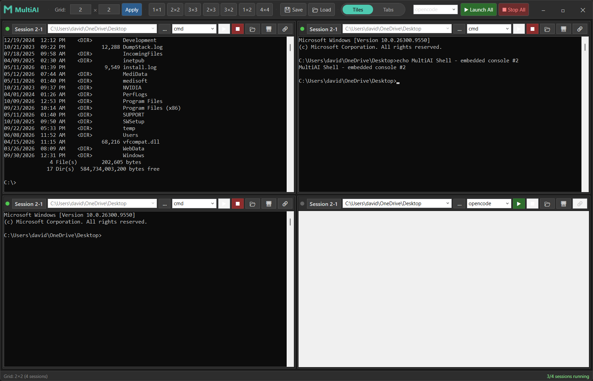
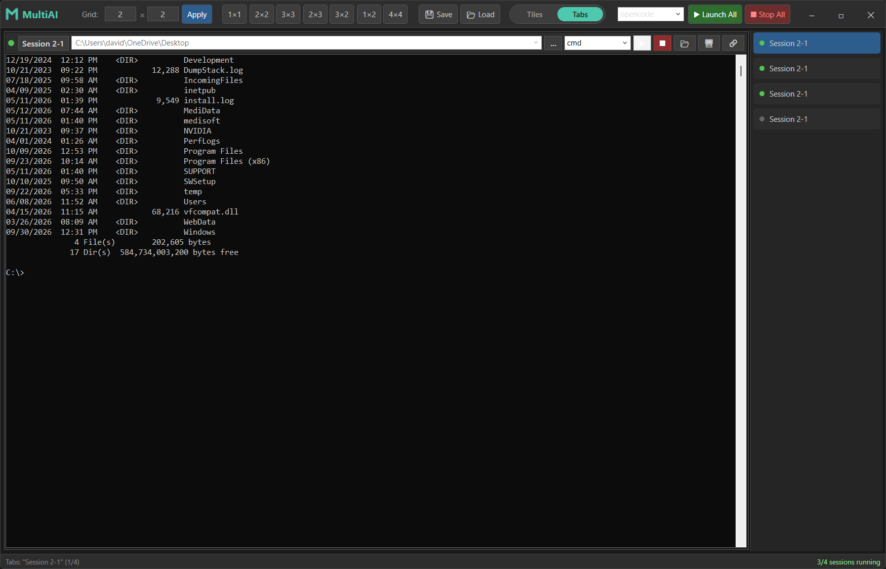

# MultiAI Shell

A Windows desktop tool for running multiple AI coding-agent console sessions side by side in a configurable grid — or in tabs — all inside a single window.

MultiAI Shell launches CLI coding agents (`opencode`, `claude`, `pi`, or any custom command) inside embedded console windows, one project directory per session, so you can supervise several agent sessions at once without juggling terminal windows.

## Screenshots

### Tile view

A 2×2 grid; each cell is a fully interactive embedded console with its own working directory and agent. Launch any subset — cells without a session stay ready.



### Tab view

Flip the Tiles/Tabs toggle and the same sessions become tabs: one shell fills the window, and the session list on the right switches between them. Running sessions keep running in both views.



## Features

- **Session grid** — any layout from 1×1 up to 10×10 via the grid fields, or pick a preset (1×1 … 4×4) from the **Presets** dropdown.
- **+ New Window** — add one session per click: windows flow left-to-right, up to 4 per row, so the 5th window sits alone on the second row and the 9th on the third. Windows always share the full window width — closing a session makes the remaining ones expand to fill the row, and vertical scrolling kicks in when the grid outgrows the window. In Tabs mode it appends a new tab.
- **Tiles / Tabs toggle** — a sliding pill switch in the toolbar flips between the tile grid and a tabbed view. In Tabs mode a session list sits on the right showing each session's name and status dot; the selected shell fills the main area like a 1×1 tile, already sized to fit when you switch. Running sessions keep running in both views.
- **Embedded consoles** — each session's console is hosted directly inside the app, with click-to-type focus across every console, per-console clipboard paste (Ctrl+V or right-click), and detach-to-window support. Sessions are launched through the classic Windows console host explicitly, so embedding works no matter what your "default terminal application" setting is — including Windows 11 24H2+, where the setting no longer honors the classic host.
- **Per-session configuration** — session name, working directory, and the agent to run. Pick the working directory from saved **label + folder** pairs (add new ones through the dropdown's *Add new entry* dialog, with a folder browser), and pick the agent from its dropdown the same way.
- **Close sessions safely** — every session has a red ✕; closing asks for confirmation, stops the session if it is running, and re-flows the grid so the remaining windows share the full width.
- **Custom agents** — add any CLI tool as an "agent" (e.g. `python`, `npm run dev`) via the *Add new entry* dialog. Names are validated against a strict whitelist (single command tokens, no shell metacharacters) since they are passed to a command line.
- **Launch All / Stop All** — start every stopped session with one agent selection from the toolbar, or stop everything at once.
- **Layout persistence** — the grid size, session names, directories, and agent assignments are auto-saved on exit and restored on startup. Saved paths and the agent list persist globally between layouts.
- **Graceful fallback** — if a console ever can't be embedded (for example after a Windows update changes console hosting), the session keeps running and is tracked as *Running (external)*: Stop still works, and the tooltip explains what happened.
- **Helper buttons per session** — open the working directory in Explorer, open it in a standalone terminal, or pop the embedded console out to (or back from) its own window.

## Requirements

- Windows 10/11
- [.NET 10 SDK](https://dotnet.microsoft.com/download) (WPF workload)
- At least one CLI coding agent installed and on `PATH` (e.g. `opencode`, `claude`) — or any other console program you add as a custom agent

## Building

```sh
dotnet build -c Release
```

Then run `bin/Release/net10.0-windows/MultiAI.exe`, or publish a self-contained build:

```sh
dotnet publish -c Release -r win-x64 --self-contained
```

## Usage

1. Start from a preset in the **Presets** dropdown, type a grid size and press **Apply**, or grow the grid with **+ New Window**.
2. In each cell (or via Launch All), pick a working directory and the agent to run.
3. Press **▶** in a cell to start that session, fill the toolbar agent box and hit **Launch All** to start them all, or **Stop All** to stop everything.
4. Flip **Tiles/Tabs** to work in a single full-size shell with a session list on the right.
5. Click any console to type in it; Ctrl+V pastes into the focused console; the red **✕** closes a session (with confirmation).
6. Names, paths, and the layout are saved automatically when you close the app.

## Security notes

Agent names are validated against a strict whitelist (single command tokens only — no shell metacharacters) before they are ever passed to a command line, both when you add them and again at launch time, since they are interpolated into a `cmd.exe` invocation.

## License

Released under the [MIT License](LICENSE).
